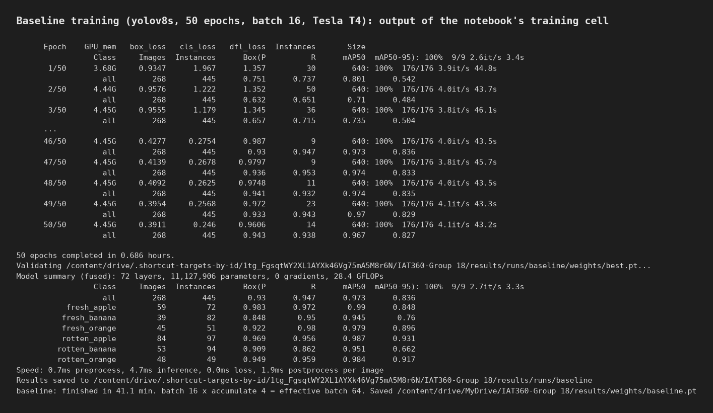
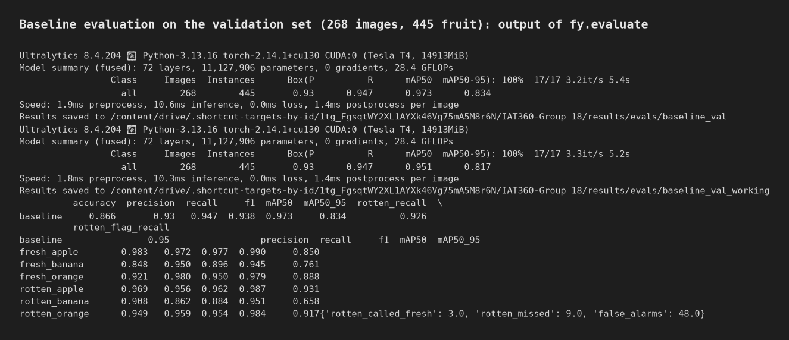
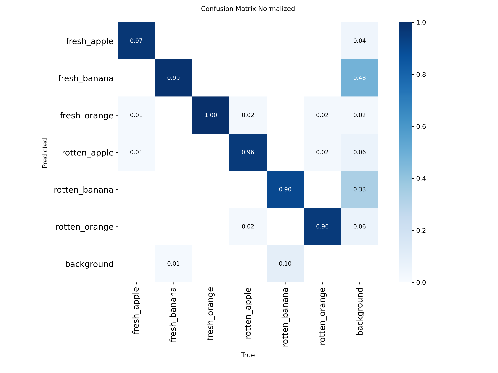
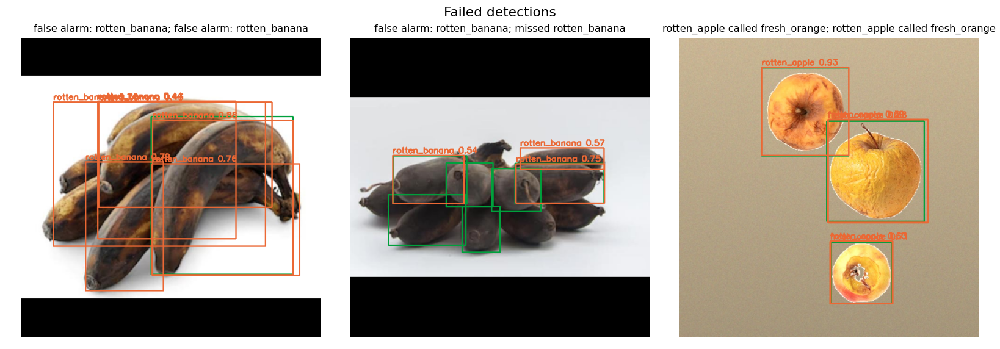
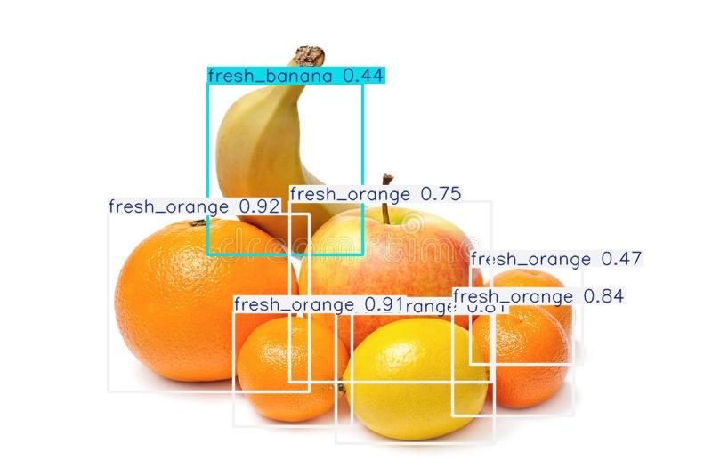
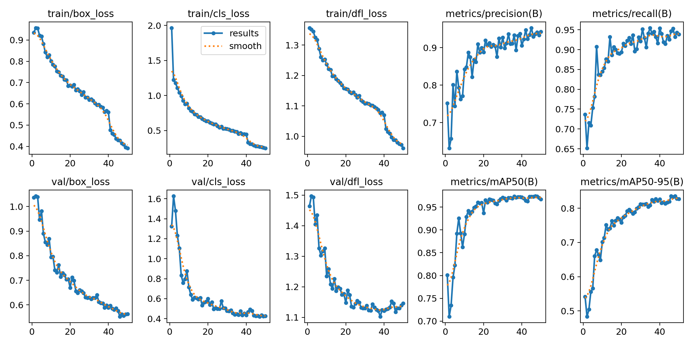
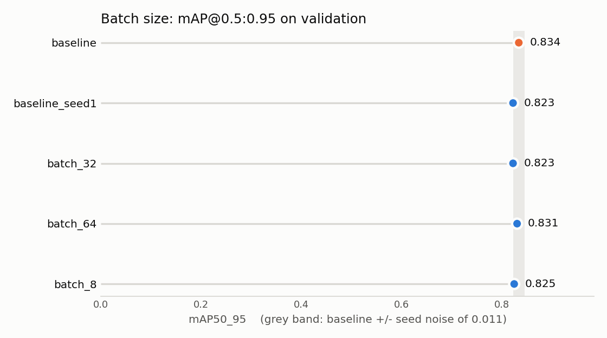
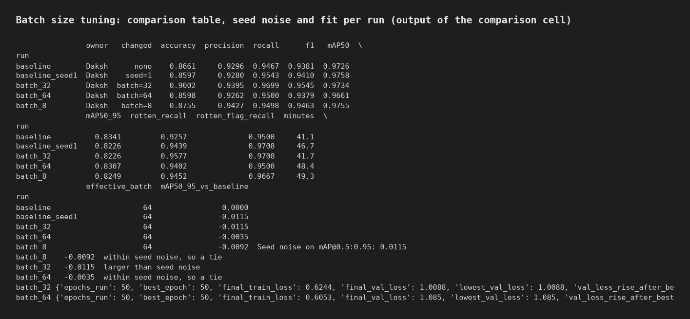

# Training report: baseline and batch size (Daksh)

Source of every number: [the notebook](../notebooks/Daksh_Setup_Baseline_BatchSize.ipynb), whose saved outputs show each
run, and the metric files in [`results/metrics/`](../results/metrics/). All runs are scored on the same validation set: 268
images, 445 fruit. The test set (our own photos) was not used; it is kept for the final evaluation.

## Baseline

**Setup.** YOLOv8s pretrained on COCO, fine-tuned for 50 epochs (patience 20) at image size 640, batch 16, AdamW with
`lr0=0.001`, seed 0, on a Tesla T4 in Colab. Training took 41.1 minutes. These are Ultralytics defaults, except that the
optimizer is written out (the default `auto` ignores `lr0`) and epochs are halved to fit the group's 17 runs on free GPUs.

| Training | Evaluation |
|---|---|
|  |  |

### Metrics

| Metric | Value |
|---|---|
| mAP@0.5:0.95 | **0.834** |
| mAP@0.5 | 0.973 |
| Precision | 0.930 |
| Recall | 0.947 |
| F1 | 0.938 |
| Accuracy (confidence 0.25) | 0.866 |
| Rotten recall (mean of the 3 rotten classes) | 0.926 |
| Rotten fruit flagged as rotten of any type | 95% |

Accuracy is correct boxes divided by correct boxes, wrong-class boxes, missed fruit and false alarms, at confidence 0.25.
Object detection has no true negatives, so this is the closest equivalent. mAP is measured at YOLO's default low confidence
because it sweeps every threshold.

| Class | Precision | Recall | F1 | mAP@0.5 | mAP@0.5:0.95 |
|---|---|---|---|---|---|
| fresh_apple | 0.983 | 0.972 | 0.977 | 0.990 | 0.850 |
| fresh_banana | 0.848 | 0.950 | 0.896 | 0.945 | 0.761 |
| fresh_orange | 0.921 | 0.980 | 0.950 | 0.979 | 0.888 |
| rotten_apple | 0.969 | 0.956 | 0.962 | 0.987 | 0.931 |
| rotten_banana | 0.908 | **0.862** | 0.884 | 0.951 | **0.658** |
| rotten_orange | 0.949 | 0.959 | 0.954 | 0.984 | 0.917 |

For our use case a rotten fruit left in the bin costs most. Of the rotten fruit in the validation set, **3 were called fresh**
and **9 were missed**; there were 48 false alarms.

### What the confusion matrix and examples show

- **Rotten bananas are the weak point.** Their mAP@0.5 is 0.951, so the model finds them, but mAP@0.5:0.95 is 0.658, so its
  boxes are loose. 10% of rotten bananas were missed entirely (bottom row).
- **Bananas cause most false alarms.** Of the predictions with no matching fruit, 48% were fresh banana and 33% rotten banana
  (background column). In dark, overlapping bunches, the model boxes bananas the annotator skipped under our "visible from
  end to end" rule, so part of this is label ambiguity rather than model error.
- **One cross-fruit error:** shrivelled, yellow rotten apples called fresh orange.

229 of 268 validation images were fully correct; 39 had at least one mistake.

**On a real photo the model never trained on**, it calls an apple and a lemon "fresh orange" and boxes only part of the
banana. The validation scores come from public images and generated composites, so the store photos in the final evaluation
are expected to score lower.

### Underfitting or overfitting?

**A reasonable fit, with the first signs of overfitting in the last four epochs.**

- For 40 epochs, validation loss tracked training loss closely (gap -0.11 at epoch 10, +0.02 at epoch 40).
- At epoch 41 YOLO turns mosaic augmentation off. Training images become easier, so training loss drops sharply (1.00 to
  0.81) and a gap of about 0.26 opens. This jump comes from the augmentation change, not from overfitting: validation loss
  kept improving and reached its lowest value (0.982) at epoch 46, where mAP@0.5:0.95 also peaked (0.836).
- After epoch 46, training loss kept falling (0.70 to 0.64) while validation loss stopped improving (0.989 at epoch 50). The
  gap widened to 0.35. The saved weights are the epoch-46 checkpoint, so the reported scores are not affected.

### Concrete fixes

1. **Rotten bananas:** add real photos of banana bunches, and re-check the existing banana labels against one rule. The
   ambiguity in what counts as one visible banana costs more here than model capacity.
2. **Rotten apples called fresh oranges:** add rotten apples with yellow skin, and keep colour augmentation limited, because
   colour is the main cue. Jasper's augmentation experiment tests this.
3. **Overfitting:** do not simply train longer at batch 16. Keep early stopping and the best checkpoint. To use more epochs,
   add data or regularisation (higher weight decay, or mosaic kept on for longer with a smaller `close_mosaic`).
4. **Domain gap:** add real, cluttered store photos to training rather than more cut-out composites.

## Batch size tuning

Baseline `batch=16`, tested at 8, 32 and 64. Everything else stayed at the baseline.

To tell a real difference from luck, I retrained the baseline once with only the random seed changed (`baseline_seed1`).
The gap between the two runs, **0.0115 mAP@0.5:0.95**, is the run-to-run noise. A setting only counts as better or worse
if it moves further than that.

| Run | mAP@0.5:0.95 | Gap to baseline | Reading | F1 | Accuracy | Rotten missed | Minutes |
|---|---|---|---|---|---|---|---|
| baseline (16) | **0.834** | | | 0.938 | 0.866 | 9 | 41.1 |
| baseline_seed1 | 0.823 | -0.012 | seed noise | 0.941 | 0.860 | 6 | 46.7 |
| batch 8 | 0.825 | -0.009 | tie | 0.946 | 0.876 | 6 | 49.3 |
| batch 32 | 0.823 | -0.012 | tie | **0.954** | **0.900** | 6 | 41.7 |
| batch 64 | 0.831 | -0.003 | tie | 0.938 | 0.860 | 11 | 48.4 |

The notebook's printed verdict calls batch 32 "larger than seed noise". Its gap equals the noise to 4 decimal places
(0.0115 against 0.0115), so it is a tie.

**Result: no batch size beat the baseline.** This is what we expected. YOLO accumulates gradients up to a nominal batch of
64 (`nbs=64`), so every run had an effective batch of 64 (8 x 8, 16 x 4, 32 x 2, 64 x 1) and updated its weights equally
often. Batch size then only changes BatchNorm statistics and speed. All four sizes fitted in the T4's 15 GB.

Two observations, neither strong enough to act on:

- Batch 32 had the best F1 (0.954) and accuracy (0.900), with the fewest false alarms (36 against 48). With one run per
  value, that cannot be separated from noise.
- Batch 8, 32 and 64 were still improving at epoch 50 (their best epoch was the last). Batch 64 rose from 0.808 at epoch 40
  to 0.831. Longer training might change the ranking; this was not tested.

**Value for the final model: keep `batch=16`.**

The same noise figure applies to the other tuning runs, since they share the baseline and validation set. For example,
`lr0=0.0003` scored 0.843, +0.009 over the baseline, which is also within 0.0115.

## Files

| What | Where |
|---|---|
| Metrics per run | [`results/metrics/`](../results/metrics/) (`<run>__train.json`, `<run>__val.json`) |
| Training curves, PR curves, confusion matrices | [`results/figures/<run>/`](../results/figures/) and `<run>_val/` |
| Correct and incorrect examples | [`results/figures/baseline/`](../results/figures/baseline/) |
| Weights | [`weights/`](../weights/) (`baseline.pt`, `batch_8.pt`, `batch_32.pt`, `batch_64.pt`, `baseline_seed1.pt`) |
| Rendered notebook output | [`results/screenshots/`](../results/screenshots/) |
