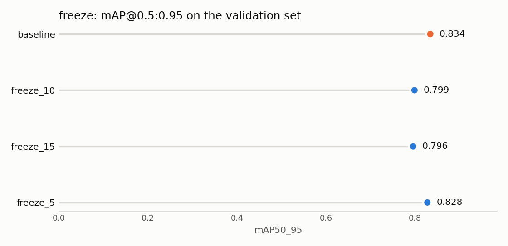

# Training report: frozen layers (Lavanya)

Source of every number: [the notebook](../notebooks/Lavanya_Licences_Freeze_FinalEvaluation.ipynb) and the metric files
in [`results/metrics/`](../results/metrics/). All runs are scored on the same validation set as the baseline: 268 images,
445 fruit. Run-to-run noise is **0.0115 mAP@0.5:0.95** (Daksh's `baseline_seed1`), so a smaller gap is a tie.

## Freeze tuning

Baseline: nothing frozen. Tested `freeze` = 5, 10 and 15, with everything else at the baseline (YOLOv8s, 50 epochs,
`imgsz=640`, `batch=16`, AdamW `lr0=0.001`, seed 0, Tesla T4). `freeze=N` stops the first N modules of YOLOv8s from
updating, keeping their COCO-pretrained weights:

- **5** freezes modules 0–4: the early backbone, which finds edges, colours and simple textures.
- **10** freezes modules 0–9: the whole backbone. Only the neck and detection head learn.
- **15** freezes modules 0–14: the backbone and half of the neck.

| Run | mAP@0.5:0.95 | Gap to baseline | Reading | mAP@0.5 | F1 | Accuracy | Rotten recall | Rotten missed | Rotten called fresh | False alarms | Minutes |
|---|---|---|---|---|---|---|---|---|---|---|---|
| baseline (none) | **0.834** | | | 0.973 | 0.938 | 0.866 | 0.926 | 9 | 3 | 48 | 41.1 |
| freeze 5 | 0.828 | -0.007 | tie | **0.977** | **0.945** | **0.868** | **0.959** | **5** | **0** | 48 | 37.8 |
| freeze 10 | 0.799 | -0.035 | worse | 0.963 | 0.921 | 0.839 | 0.925 | 11 | 2 | 51 | 36.0 |
| freeze 15 | 0.796 | -0.038 | worse | 0.960 | 0.917 | 0.816 | 0.904 | 9 | 2 | 65 | 36.3 |

Per-class mAP@0.5:0.95:

| Run | fresh apple | fresh banana | fresh orange | rotten apple | rotten banana | rotten orange |
|---|---|---|---|---|---|---|
| baseline | 0.850 | 0.761 | 0.888 | 0.931 | 0.658 | 0.917 |
| freeze 5 | 0.841 | 0.725 | 0.902 | 0.925 | 0.665 | 0.908 |
| freeze 10 | 0.814 | 0.721 | 0.871 | 0.891 | 0.603 | 0.892 |
| freeze 15 | 0.817 | 0.735 | 0.816 | 0.894 | 0.626 | 0.886 |

**Result: no freeze value beat the baseline.** Freezing 5 modules is a tie (-0.007, inside the 0.0115 noise). Freezing 10
or 15 is clearly worse, about three times the noise.

**Why.** The first few modules detect generic edges and colours that COCO pretraining already learned well, so freezing
them costs almost nothing. Rot is a texture and colour change (mould, brown patches, wrinkled skin) that COCO's 80
classes never had to separate. When the whole backbone is frozen (10) or part of the neck too (15), the model cannot
learn those features, and the hardest class suffers most: rotten banana falls from 0.658 to 0.603 with `freeze=10`. The
fit reports agree. `freeze_15` was still improving at epoch 50 (best epoch 49, validation loss still falling), which is
underfitting: too few trainable layers to learn the task in 50 epochs. `freeze_5` and `freeze_10` levelled off normally.

**Speed.** Freezing saved only 3 to 5 minutes (8 to 12%). The frozen layers still run forward on every image; only their
gradient updates are skipped, and the T4 was not the bottleneck at this model size.

**One observation, not strong enough to act on:** `freeze_5` had the best rotten recall of all four runs (0.959 against
0.926). It missed 5 rotten fruit instead of 9 and called none fresh. That fits the project's priority, but it is one run.
The baseline and `baseline_seed1` differ by 0.018 in rotten recall from the seed alone, so this needs a second seed
before it can be trusted.

**Value for the final model: keep the baseline (nothing frozen).** This follows the group's rule that a gap inside the
noise is a tie. If the group decides to rank by rotten recall instead of mAP, `freeze=5` is the value to try.

## Files

- Metrics: `results/metrics/freeze_{5,10,15}__{train,val}.json`
- Training curves and confusion matrices: `results/figures/freeze_{5,10,15}/` and `results/figures/freeze_{5,10,15}_val/`
- Weights: `weights/freeze_{5,10,15}.pt`
